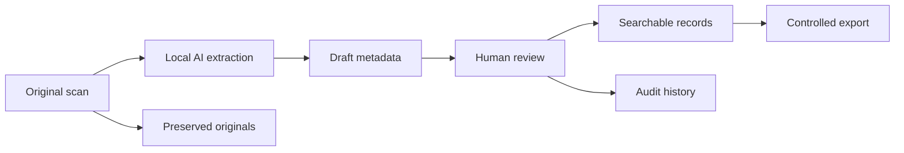

# Case study: AI-assisted broadcast archive digitization

**Role:** AI technical owner / full-stack delivery lead  
**Stage:** Client pilot; not a claim of full production rollout  
**Disclosure:** Anonymized case study. No client records, images, source code, credentials or contractual details are included.

## Problem

A broadcast archive contains historical story-index cards that are difficult to search without manual inspection. The goal is to make the information discoverable while preserving the original evidence and keeping people in control of transcription and catalog decisions.

## Delivery approach

1. Preserve the original scanned image as the source of truth.
2. Use local vision-language inference to draft structured metadata.
3. Route uncertain or incomplete fields into a human review workflow.
4. Track corrections and verification as auditable events.
5. Expose searchable records and controlled exports.
6. Keep any catalog matching separate from transcription; require evidence before a match is confirmed.

## Engineering and program decisions

| Decision | Rationale |
| --- | --- |
| Local inference | Reduce external transfer of archive material and manage inference dependencies. |
| Human verification | AI output is a draft, not an authoritative record. |
| Preserve originals | Retain source evidence when metadata changes. |
| Separate synthetic demonstration | Show the search experience without exposing real client data. |
| Quality-gated delivery | Measure accuracy, throughput, integrity and operational readiness separately. |

## Evidence and validation

The pilot codebase documents a review workflow, search, exports, preservation safeguards, automated regression tests, and explicit acceptance criteria. A separate demonstration uses fictional records to exercise the search experience at six-figure catalog sizes.

The validation strategy distinguishes:

- Search latency and responsiveness from physical scanning throughput.
- AI field presence and reviewer agreement from independently measured transcription accuracy.
- Synthetic catalog scale from end-to-end production readiness.
- Candidate catalog matches from human-confirmed links.

**Not claimed:** independently verified handwriting accuracy, full archive completion, confirmed tape matches at scale, or proven production capacity. The production repository and client data remain private. A sanitized demonstration may be shared with permission.

## What this demonstrates

AI product definition, human-centered workflow design, architecture tradeoffs, responsible AI controls, test planning, operational metrics, and delivery ownership from ambiguous requirements to a working pilot.

[Back to portfolio](../README.md)
